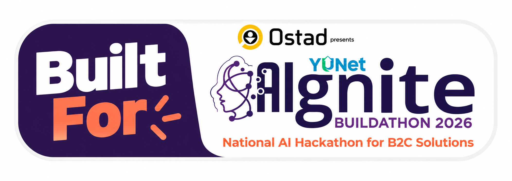
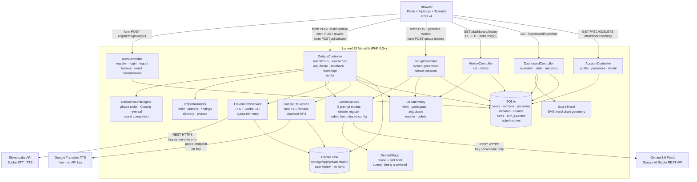
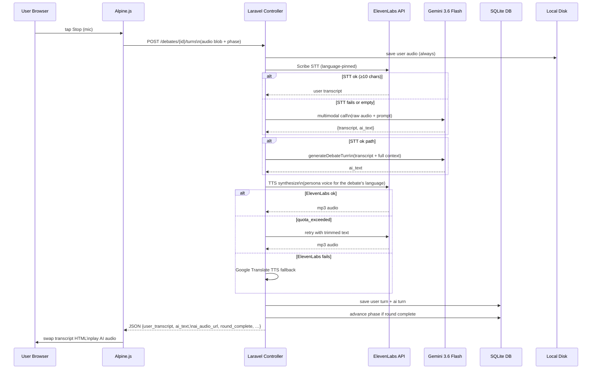
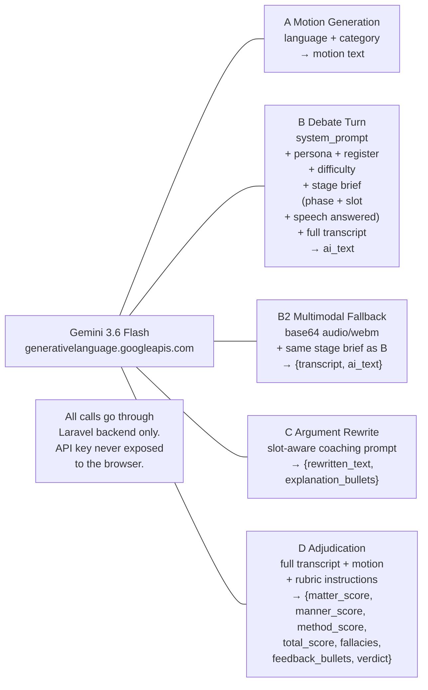
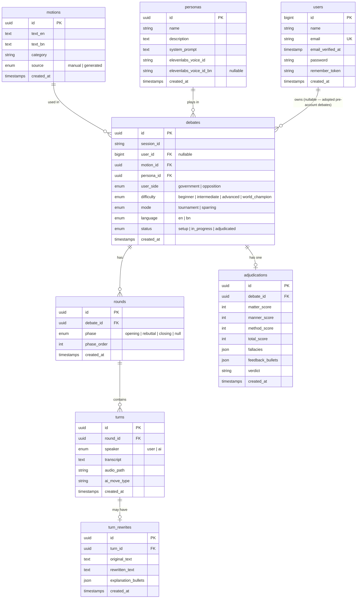
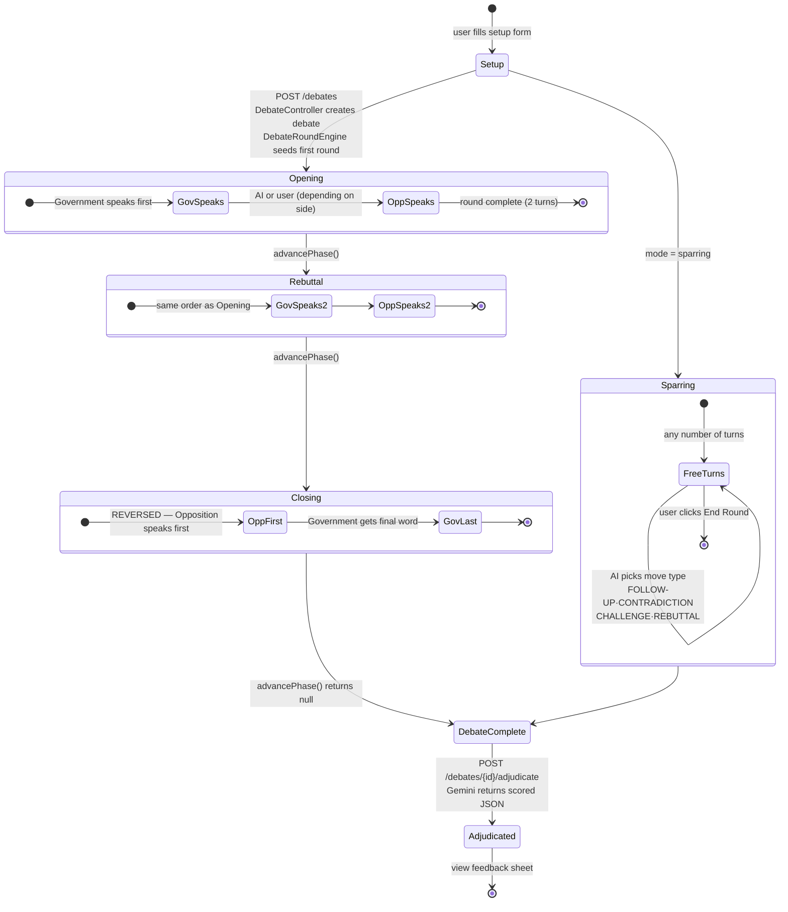

# Rostrum — AI Debate Training Platform



## Table of Contents

- [Rostrum — AI Debate Training Platform](#rostrum--ai-debate-training-platform)
	- [Table of Contents](#table-of-contents)
	- [Live Demo Link](#live-demo-link)
		- [Demo Account](#demo-account)
	- [What It Does](#what-it-does)
	- [Problem \& Impact](#problem--impact)
		- [What Problem Does the Project Solve?](#what-problem-does-the-project-solve)
		- [Who Benefits?](#who-benefits)
		- [What is the Potential Impact?](#what-is-the-potential-impact)
	- [How to Use](#how-to-use)
	- [Features](#features)
		- [1. Core Debate Engine](#1-core-debate-engine)
		- [2. AI Opponent — Gemini 3.6 Flash](#2-ai-opponent--gemini-36-flash)
		- [3. Voice Round-Trip — ElevenLabs](#3-voice-round-trip--elevenlabs)
		- [4. Fallback Chain (every third-party call has one)](#4-fallback-chain-every-third-party-call-has-one)
		- [5. Argument Rewrite Assistant](#5-argument-rewrite-assistant)
		- [6. AI Personas \& Difficulty](#6-ai-personas--difficulty)
		- [7. Adjudication Report](#7-adjudication-report)
		- [7a. One Rubric, Not Two](#7a-one-rubric-not-two)
		- [8. Practice Analytics](#8-practice-analytics)
		- [9. History \& Session Management](#9-history--session-management)
		- [10. Accounts \& Access Control](#10-accounts--access-control)
		- [11. Security Model](#11-security-model)
		- [12. Language Parity (English / Bangla)](#12-language-parity-english--bangla)
		- [13. Arena Layout \& Accessibility](#13-arena-layout--accessibility)
		- [13a. The Workspace Shell](#13a-the-workspace-shell)
	- [How We Used the APIs](#how-we-used-the-apis)
		- [Gemini API (via Google AI Studio)](#gemini-api-via-google-ai-studio)
		- [ElevenLabs API](#elevenlabs-api)
	- [Architecture](#architecture)
		- [1. System Overview](#1-system-overview)
		- [2. Per-Turn Data Flow (Tournament Mode)](#2-per-turn-data-flow-tournament-mode)
		- [3. Gemini Prompt Modes](#3-gemini-prompt-modes)
		- [4. Fallback Chain](#4-fallback-chain)
		- [5. Database Schema (ER Diagram)](#5-database-schema-er-diagram)
		- [6. Debate Round State Machine](#6-debate-round-state-machine)
	- [Tech Stack](#tech-stack)
	- [Requirements](#requirements)
	- [Deployment](#deployment)
	- [Local Setup](#local-setup)
	- [Testing](#testing)
	- [Project Structure](#project-structure)
	- [Data Model](#data-model)
	- [Known Limitations](#known-limitations)
	- [Author](#author)

## Live Demo Link

**Live Site:** https://rostrum.onrender.com

### Demo Account

Sign in with the seeded account to see the product with a record already on it — a completed debate and its adjudication report:

| | |
|---|---|
| **Email** | `demo@rostrum.app` |
| **Password** | `rostrum-demo` |

> The same panel is on the live sign-in screen under **"Try the demo account"**, with a button that fills both fields for you.

The demo debate belongs to this account alone — no other account can read it, and every newly registered account opens on an empty history. You are welcome to change the password; it is stored per environment, so a password set on the live demo does not affect a local install.

> **Note:** The demo is hosted on Render's free tier and may take a while to load on the first request due to cold starts.

> **Note:** As the live site is using free tiers of Gemini and ElevenLabs, the demo may run out of credits anytime and fail to generate speeches. So we recommend you to run the demo locally by following the [Local Setup](#local-setup) instructions using your own API keys.

## What It Does

Rostrum is an on-demand debate sparring partner, coach, and judge — rolled into a single web app.

A user picks a debate motion (or generates one with Gemini), selects a side, an AI persona, and a difficulty level, then debates **by speaking aloud** through a structured 3-phase round (Opening → Rebuttal → Closing). The AI opponent argues back in character — using **Gemini 3.6 Flash** for reasoning and **ElevenLabs** for a distinct spoken voice and transcription. After the round, Gemini acts as a formal adjudicator and produces a scored feedback sheet modeled on real Asian Parliamentary debate rubrics.

In mid-debate, the user can tap "Improve argument" on any of their own speeches. Gemini rewrites it live — showing a slot-aware before/after that visually demonstrates the model improving human reasoning in real time, not just answering a question.

Every practice belongs to an account. The overview page turns a record of debates into a picture of a debater's practice — a score trend over time, where the marks are won, and how much of each phase's time was actually used.

The entire experience works in both **English and Bangla**, end to end: motions, AI arguments, spoken voice (with native Bangla voices), rewrite suggestions, and adjudication feedback.

## Problem & Impact

### What Problem Does the Project Solve?
Competitive debate is a cornerstone of critical thinking, public speaking, and civic engagement across universities. However, effective debate preparation requires three distinct roles: a **sparring partner** to challenge arguments, a **coach** to refine rhetoric, and an **adjudicator** to evaluate structured speeches.

Existing learning avenues fail debaters in three critical ways:
1. **Scarcity of Judged Practice:** Club practice sessions are strictly scheduled, leaving students with limited opportunities for feedback outside weekly meetings.
2. **Language Barrier:** Almost all AI tools, practice platforms, and rubrics cater exclusively to English, leaving native **Bangla debaters** without localized sparring tools.
3. **Static Feedback:** Generic AI chatbots provide unfocused answers rather than evaluating Parliamentary debate rules (Matter, Manner, Method), detecting logical fallacies, or coaching users on phase-specific speech strategies.

### Who Benefits?
- **University & School Debaters:** Students preparing for Asian Parliamentary (AP) or World Schools Debate Championship (WSDC) circuit tournaments who need solo, on-demand practice.
- **Bangla Circuit Participants:** Native speakers looking for high-quality bilingual debate motions, native Bangla speech synthesis, and structured feedback in Bangla.
- **Public Speaking & Logic Learners:** Anyone looking to improve critical reasoning, argument structuring, and quick-thinking skills under real-time speech pressure.

### What is the Potential Impact?
- **Democratized Debate Training:** Rostrum acts as an instant, 24/7 personalized coach for debaters regardless of geographical or financial constraints.
- **Bilingual Empowerment:** By keeping the whole round bilingual — motions, STT, AI turns, speech rewrites, and the judge's own findings — Rostrum bridges the tech gap for regional debate circuits in South Asia.
- **Actionable AI-Powered Pedagogy:** Rather than just scoring a debate at the end, Rostrum's live "Improve argument" feature visually demonstrates how to transform weak reasoning into tournament-grade speeches in real time.

## How to Use

> **An account is required to use the app.** Only the landing page, the sign-in screen and the registration screen are public — every other page needs a signed-in account. Your history, reports and voice recordings belong to that account.
>
> A seeded demo account is created by the seeders — see [Demo Account](#demo-account) for the credentials. It owns the seeded demo debate and its adjudication report. That demo debate belongs to the demo account alone — no other account can read it, and every newly registered account opens on an empty history.

1. **Overview (`/dashboard/overview`):**
   - Sign in and land on the overview page: your metric strip (debates, reports, average and best score), your score trend over time, where your marks are won, and your four most recent debates. A new account starts with nothing on record, and fills the page by debating.
   - The four main pages — Overview, New Debate, History and Settings — are always in the nav rail, and signing out sits in the rail too rather than behind a menu.

2. **Configure Your Debate Session (`/dashboard/setup`):**
   - **Language:** Choose between English or Bangla. The AI opponent answers in the same language, and the voice you hear changes with it.
   - **Motion:** Select a pre-loaded topic, enter your own motion, or click **"Generate with Gemini"** for an AI-suggested motion.
   - **Side:** Choose **Government** (Proposing) or **Opposition** (Opposing).
   - **AI Persona:** Select your AI practice partner (**Calm Logician**, **Aggressive Cross-Examiner**, or **Devil's Advocate**).
   - **Difficulty:** Pick from **Beginner**, **Intermediate**, **Advanced**, or **World Champion**.
   - **Format:** Choose **Tournament Mode** (structured 3-phase round) or **Sparring Mode** (flexible back-and-forth).

3. **Enter the Arena (`/debates/{id}`):**
   - Click the **Mic button** to begin recording your speech. On a phone the mic docks at the foot of the screen, with the phase clock beside it.
   - Speak your arguments clearly in your chosen language.
   - Click **Stop** when finished — ElevenLabs Scribe will transcribe your voice while Gemini generates the AI opponent's response.
   - Hear the AI speak back in its designated ElevenLabs voice — a native Bangla voice in a Bangla debate.

4. **Improve Your Arguments Mid-Debate:**
   - Tap **"Improve argument"** under any of your speech bubbles.
   - View Gemini's live, slot-aware rewrite along with 2-3 coaching pointers explaining what was strengthened. The rewrite is targeted by the phase *and* the slot: a reply is coached as a reply, and an opening as an opening.

5. **Review Your Adjudication Report (`/debates/{id}/feedback`):**
   - Complete all rounds (Opening, Rebuttal, Closing) and click **"View Adjudication →"** in the podium. In Sparring Mode the round has no fixed phases, so you end it yourself with **"End Round & Get Feedback"**.
   - Read the **short version** first — four lines saying what the mark means, what worked, what cost you, and the one thing to change.
   - Work down through the scorecard, the findings grouped by kind and anchored to a phase, the reasoning errors, and the round itself.
   - Check how much of your time you actually used against each phase's budget.
   - Export your report as a **PDF** or copy the full debate transcript as a text file.

## Features

### 1. Core Debate Engine
- **Tournament Mode** — 3-phase structured format: Opening (3 min) → Rebuttal (2 min) → Closing (2 min), following WSDC/Asian Parliamentary 1v1 convention. Closing reverses speaking order (Opposition first) so Government delivers the final word, matching real reply-speech rules.
- **Sparring Mode** — Informal adaptive back-and-forth. The AI picks its move dynamically: follow-up question, contradiction callout, live challenge, or standard rebuttal. It tags its move type (`[FOLLOW-UP]`, `[CHALLENGE]`, etc.) which is parsed, stored in the DB, and shown as a badge on the AI's bubble. The tag set is **closed on purpose** — only those four tags are recognised, so a bracket that is not one of them (a quoted phrase, a citation) stays in the speech where it belongs instead of being swallowed by the parser.
- **Phase-aware turn engine** — `DebateRoundEngine` enforces speaking order by phase, including the Closing reversal. First-speaker logic is computed from `user_side` + `phase`, never guessed.
- **Slot-aware stage brief** — `DebateStage` works out where a speaker stands when they speak: the phase, the slot within it (first or second), the speech they are answering, and what their own side has already established. The slot is derived from the round's actual turns, not from a counter, so a round that was resumed or partly failed still describes itself correctly.
  - **A note on reading the config.** The stage profiles and the word counts are keyed `"{phase}.{first|second}"` — the key itself contains a dot. They are read as **flat array keys** (`config('debate.stage_profiles', [])[$key]`), *not* through Laravel's dot-notation lookup, because `config('debate.stage_profiles.opening.first')` resolves to the `first` key *inside* `opening` — which silently falls every profile back to `sparring`, and puts the "Sparring Exchange" role on a tournament opening.

### 2. AI Opponent — Gemini 3.6 Flash
- One Gemini call per AI turn, given: the full prior transcript (labeled per phase and per role), a **stage brief**, the persona's system prompt, the debate register, the difficulty modifier, and the motion + side.
- **The stage brief — phase AND slot aware:** a phase holds two speeches and the two are not the same speech, so the prompt names the slot as well as the phase. The first speaker of the opening builds the case; the second *answers* it. The first speaker of the closing weighs the debate; the second takes the last word. The brief carries the speech being answered (quoted verbatim), what the speaker's own side has already put into the round, and which phases are still to come — so a closing introduces no new arguments and a reply does not rebuild a case already made.
- Five distinct prompt modes, all through the same model: motion generation (A), debate turn (B), Gemini multimodal audio fallback (B2), argument rewrite (C), and adjudication (D).
- **Debate register:** a shared directive that makes the output a speech rather than an essay — signposted, in full spoken sentences, with no headings or markdown, and each argument given as claim → mechanism → impact. The sides speak under their parliamentary roles (the Prime Minister, the Leader of the Opposition) rather than as "you" and "the AI", which gives the AI a stance to argue from and the transcript the shape of a debate.
- **Slot-aware rewrite (C):** the rewrite prompt changes what it optimises for by phase *and* slot — Opening = build the constructive case; Rebuttal = sharper surgical clash; Closing = impact comparison and persuasive framing. A reply stays a reply; an opening stays an opening. The rewrite is cached per turn so repeat requests are instant.
- **Structured adjudication (D):** Gemini returns strict JSON scored on Matter (/40), Manner (/30), Method (/30) + fallacy list + 3–5 grounded feedback bullets (each quoting the user's exact words from the transcript) + a verdict. A `parseJson` helper strips stray markdown fences and falls back gracefully if JSON decoding fails.
- **Retry/resilience:** Failed calls are retried up to 5 times with a 3-second pause, and only on a rate limit (429) or a temporary server error (500/502/503/504) — a 400 is not retried, because asking again will not change the answer. The multimodal audio fallback gets 3 attempts. Human-readable error messages — never a raw exception — are returned to the page if every attempt fails. Round state is always preserved.

### 3. Voice Round-Trip — ElevenLabs
- **STT:** ElevenLabs Scribe (`scribe_v1`) transcribes the user's audio. Language is pinned (`eng`/`ben`) per debate — never auto-detected mid-round.
- **TTS:** Each AI persona carries **two** ElevenLabs voice IDs — one English, one Bangla. The debate's language picks the voice:
  - Calm Logician → **Adam** (`pNInz6obpgDQGcFmaJgB`) / **Fahad Mir** (`d532cgnzlrx7AWL3CD9i`)
  - Aggressive Cross-Examiner → **Bella** (`EXAVITQu4vr4xnSDxMaL`) / **Rayhan** (`vvOYlSJHf8lTWIG4tDNP`)
  - Devil's Advocate → **Liam** (`TX3LPaxmHKxFdv7VOQHJ`) / **Rakib** (`VizHiwkPO7hXc967v4tE`)
  - The Bangla voices are native Bangla recordings, so a Bangla debate sounds like Bangla rather than an English voice reading Bangla. A persona with no Bangla voice falls back to its English one, so synthesis never goes silent.
- Model is language-aware: `eleven_multilingual_v2` for Bangla (best phonetics), `eleven_turbo_v2_5` for English.
- **Quota-trim retry:** When ElevenLabs reports `quota_exceeded`, the remaining credit count is parsed from the error body, text is trimmed to fit the budget (with a 15% safety margin), and the request is retried once automatically — a debate never runs silent because credits ran low.
- **Voice name badge** in the podium names the voice in use, so it's instantly visible which ElevenLabs voice is speaking.

### 4. Fallback Chain (every third-party call has one)
1. **STT:** Scribe fails / returns <10 chars → Gemini multimodal audio (transcribes + generates AI response in a single call, no extra latency) → still failing: turn saved with empty transcript, friendly note shown, AI still responds, round continues.
2. **TTS:** ElevenLabs fails (or quota exhausted after retry) → **Google Translate TTS** (free public endpoint, chunks text at ~190-char sentence boundaries and concatenates MP3 fragments) → still failing: text-only fallback with a visible notice. The AI's text is always visible regardless.
3. **Motion generation:** Gemini fails → random motion from curated English/Bangla fallback lists.
4. User audio is always saved to disk even when STT fails. Partial results (`stt_error`, `ai_error`) are always included in the JSON response — Alpine.js handles whatever succeeded.

### 5. Argument Rewrite Assistant
- Available mid-debate on any of the user's own turns — not locked to the end of a round.
- Sends transcript + motion + side + phase to Gemini → returns a full rewritten version + 2–3 short bullets explaining what changed.
- Renders as a full-width "Enhanced Version" card below the user's turn in the arena, with the bullets under a "What changed" heading. The card is rendered by a shared `x-rewrite-panel` component on the server-rendered path and by the same markup inline in JavaScript on the live path, so a rewrite looks the same whether the page was loaded before or after the turn was spoken.
- Rewrite does NOT replace the user's turn in the transcript sent to the AI or scored by the adjudicator — it's a pure coaching tool.

### 6. AI Personas & Difficulty
Three personas × four difficulty levels — orthogonal axes:
- **Persona** controls *style*: Calm Logician (structured, evidence-led), Aggressive Cross-Examiner (rapid-fire challenges), Devil's Advocate (contrarian, wry).
- **Difficulty** controls *skill*: Beginner (lets weaknesses pass) → Intermediate (club-level) → Advanced (tournament-level, link-turns, impact calculus) → World Champion (identifies the single weakest link and targets it directly).
- Difficulty is implemented as a config-based prompt fragment appended at call time — no extra DB columns, no extra API calls.

### 7. Adjudication Report
A scorecard on its own tells a reader where points were lost but not what to do about it. The report is therefore built around `App\Support\ReportAnalysis`, which reads the adjudication and the transcript and returns everything the page renders. Nothing in it is invented and nothing in it is stored — it is all derived at request time.

- **The brief** — four lines of ordinary language at the top: what the mark means, what worked, what cost the round the most, and the one thing to change. A reader who wants only the brief never has to scroll past it.
- **The grade ladder** — the whole scale with the mark placed on it, so the reader sees the round in the context of the rubric rather than as a bare number. Each band shows the points it starts at, how far through the band the mark sits, and how many points short of the band above it is.
- **Per-criterion ladders** — Matter, Manner and Method each carry their own band scale with the band the score landed in marked, because the criteria have different weights (40 / 30 / 30). Each score is shown as a *percentage of its own maximum*, so a 22/30 is correctly read as a stronger showing than a 22/40.
- **Findings, grouped and anchored** — the judge's bullets are parsed into `[STRENGTH]` / `[ISSUE]` / `[TIP]` / `[DRILL]` groups (unrecognised tags become a *note* rather than being dropped) and each is anchored to the phase it refers to, so the reader knows which speech to reopen. A closing recommendation without a `[DRILL]` tag is promoted to the drill, since the prompt's contract puts the practice plan last.
- **Verified quotes only** — a quoted phrase is shown as the speaker's words only if it can actually be found in the speaker's own turns. The judge quotes the opponent often enough that an unverified attribution would put words in the speaker's mouth.
- **Delivery analysis** — estimated speaking time against each phase's budget, at 140 wpm. A phase answered in forty seconds out of a three-minute budget is a fact about the round the mark alone does not carry. Under 55% is reported as a shortfall, over 105% as an overrun.
- **Bangla-aware word counts** — Bangla is written without spaces between words, so a whitespace count would report one word for a whole paragraph. Counts fall back to characters (scaled by the ~5-character average Bangla word) when the debate is in Bangla.
- Verdict, 100-point score breakdown, fallacy count badge on the cover, color-coded progress bars, per-fallacy phase tags, printable PDF via `window.print()` with `@media print` CSS, copyable transcript.

### 7a. One Rubric, Not Two
The judge and the report read from the same source. `config('debate.rubric')` holds the three criteria, their weights, their band descriptors and the overall grade bands — and `GeminiService::rubricPromptText()` writes that config into the adjudication prompt. The judge is told where each band starts, so it does not invent its own thresholds, and the report never prints a band the judge did not apply. A report that describes a rubric the judge never scored against is a document that misrepresents its own method.

### 8. Practice Analytics
The overview page turns a record of debates into a picture of a debater's practice. Every figure is scoped to the signed-in account, so a stat never counts somebody else's debate.

- **Metric strip** — debates, reports, average score and best score. The reports tile is counted from the *reports*, not from the debates: a debate in progress has no mark, and a note sitting under the reports count has to describe the same set the count names.
- **Score trend** — every scored debate plotted oldest-first, so the line reads left-to-right as time passing. Only scored debates carry a point, so an unfinished debate is a *gap* rather than a zero — plotting it as zero would draw a collapse in performance that never happened. The chart is drawn by `App\Support\ScoreTrend` as an SVG plot: a fixed 640 × 200 coordinate space stretched to any width, with gridlines at 0/25/50/75/100 and each reading placed above its point (or below it, when a point sits too near the top to have room above).
- **Rubric averages** — where the marks are won, each criterion read against its own maximum (Matter /40, Manner /30, Method /30) rather than against 100.
- **Reports by difficulty** — every difficulty is listed even when it has no reports yet, because a bar chart whose axis changes shape between visits is harder to read, not easier.
- **Readable without colour** — the trend's scale sits outside the plot and the readings are real text laid over it, so the chart never depends on colour alone to be read and the numbers stay the same size whatever the chart is scaled to. The chart carries an `aria-label` that states the range and every score in the series.

### 9. History & Session Management
- Debate history is **account-scoped** — every debate in the list belongs to the signed-in account, so history follows the user across devices and browsers.
- **Format tabs** (Tournament / Sparring) open on the format the reader actually has records for, so the page never opens on an empty tab.
- **Search** by motion text, **filter** by status (adjudicated / in progress), and **sort** by newest, oldest, highest score or lowest score. The record count follows the active tab and its filters, so the header always agrees with the table below it.
- Every row carries its format, side and difficulty, and an in-progress session is labelled as such rather than given a score.
- The seeded demo debate belongs to the demo account alone. It is **not** pushed into any other account's history — an account's record is a record of that account's own practice — and a newly registered account opens on an empty ledger.

### 10. Accounts & Access Control
- **An account is required to use the app.** Only three pages are reachable without one: the landing page, the sign-in screen and the registration screen. Every dashboard page and every endpoint behind it requires a signed-in account.
- **Register / Sign In / Sign Out** (`/register`, `/login`). Signing out sits in the navigation rail rather than behind an account menu — a menu holding one button was a click for nothing, and the destinations it used to repeat are listed directly above it.
- **Four main pages, one click apart.** The nav keeps them permanently in reach for a signed-in account:

  | Page | Route | What it holds |
  |---|---|---|
  | Overview | `/dashboard/overview` | Metric strip (debates, reports, average & best score), a score-trend chart, rubric averages (Matter / Manner / Method), reports by difficulty, and the four most recent debates |
  | New Debate | `/dashboard/setup` | Language, motion, side, persona, difficulty and format for the next session |
  | History | `/dashboard/history` | Every debate the account owns, with search and filters |
  | Account Settings | `/dashboard/settings` | Profile, password, and account deletion |

- **Overview page** (`/dashboard/overview`) — the landing page after sign-in, and a report rather than a launcher: the rail already carries the one action the product exists for. It opens with a metric strip, then three analytics — the **score trend** (every scored debate plotted oldest-first, so the line reads as time passing), **rubric averages** (where the marks are won, read against each criterion's own maximum) and **reports by difficulty** — then the four most recent debates. A brand-new account is never a blank screen: it gets a "Start Your First Debate" call to action. Nothing is shown twice: the four recent debates are the only list of sessions on the page, and an unscored session is labelled *In progress* rather than given a zero.
- **Account settings** (`/dashboard/settings`) — profile, password, and account deletion only. The page states the account once (name, email, and when it was opened) and then the four things that can be changed about it. It deliberately carries **no statistics**: a settings page that also reports your numbers is asking for attention it has not earned, and the overview already owns the full stat display.
- **Seeded account** — `SeedAccountSeeder` creates a demo account that owns the seeded demo debate *and* its adjudication report, so signing in opens an account that already has a debate and a report on record. Credentials come from `SEED_ACCOUNT_*` in the environment.
- Deleting an account cascades to every debate, round, turn, rewrite and adjudication it owns.

### 11. Security Model

The authorization rules are enforced in one place — `App\Policies\DebatePolicy` — so every route that touches a debate checks the same rule. Laravel resolves a policy method before a string gate of the same name, which is why `can:view,debate`, `can:participate,debate`, `can:adjudicate,debate`, `can:rewrite,debate` and `can:delete,debate` all land on the policy.

| Ability | Rule |
|---|---|
| `view` | The owner only |
| `participate` | The owner only |
| `adjudicate` | The owner only |
| `rewrite` | The owner only |
| `delete` | The owner only |

There is **no shared sample**. The seeded demo debate is owned by the demo account like any other debate, so an account's record is a record of that account's own practice and nobody else's — and a newly registered account opens on an empty ledger.

**Public surface** — `/`, `/login`, `/register`, plus `/healthz` for monitors. Everything else redirects anonymous visitors to the sign-in screen, remembering the intended URL so a deep link survives sign-in. The protected set is `/dashboard/*`, `/debates/*` and every write endpoint behind them.

**Ownership (IDOR)** — the policy is applied both as route middleware and again inside `DebateController` (defence in depth). A turn may only be rewritten through the debate it belongs to, so a turn from one debate cannot be reached through another debate's URL.

**Voice recordings are private.** User recordings and synthesised speech live on the *private* disk and are streamed back through `GET /debates/{debate}/audio/{file}`, which checks ownership. They are never served off the public disk, and the response is marked `Cache-Control: private` so a shared proxy cannot keep serving a recording after the owner signs out. The file name is reduced to a bare filename and matched against a strict pattern before it is read, so the endpoint cannot be used to traverse outside the audio directory.

**JSON endpoints answer JSON.** The `fetch()` endpoints (motion generation, turn submission, adjudication, rewrite) send `Accept: application/json`, so a validation failure comes back as a `422` JSON body with a field-error map instead of an HTML redirect page — the browser can then show the actual reason rather than a generic failure. Ordinary form posts (the debate setup form) keep the redirect-back-with-errors behaviour the Blade views rely on, and an anonymous `fetch()` gets a `401` JSON body rather than a redirect it cannot parse.

**Brute-force protection** — five failed sign-ins lock an account for 15 minutes (counted per account, so one attacker cannot lock everyone out). A successful sign-in clears the counter. The route-level throttle is a backstop for the *spray* pattern: 12 attempts/min per address+IP and 20/min per IP.

**Rate limits** — sign-in 12/min per account+IP and 20/min per IP; registration 5/min and 20/hour per IP; AI-backed endpoints 20/min and 300/hour per account, with a 60/min per-IP ceiling.

**Passwords** — at least 10 characters with upper case, lower case and a digit, enforced on registration *and* on password change. Email addresses are lower-cased and trimmed before validation, so `Ada@Example.com` and `ada@example.com` cannot become two accounts.

**Sessions & headers** — the session ID is regenerated on sign-in (no session fixation) and invalidated on sign-out; cookies are `HttpOnly` and `SameSite=Lax`, and `Secure` when `SESSION_SECURE_COOKIE=true` (set in `render.yaml` for the deployed environment). Every response carries `X-Content-Type-Options`, `X-Frame-Options`, `Referrer-Policy`, `Cross-Origin-Opener-Policy` and `Permissions-Policy` from `App\Http\Middleware\SecurityHeaders`. CSRF protection ships with Laravel's default `web` middleware group and is applied to every form and every `fetch` call.

> **No Content-Security-Policy.** The app loads Google Fonts and a CDN fallback for Alpine.js, and it uses inline Alpine.js expressions throughout. A strict CSP would need nonces threaded through every view, plus an explicit allowlist for the font and script origins. That is a larger change and is deliberately left out rather than half-done.

**Outbound calls** — TLS verification is on for every Gemini and ElevenLabs request. It used to be disabled (`Http::withoutVerifying()`), which let a proxy on the path read API traffic in the clear; it is now enabled, and the Docker image installs `ca-certificates` and runs `update-ca-certificates` so the certificate chain can actually be validated.

### 12. Language Parity (English / Bangla)
- UI strings are in English; the **debate content** is fully bilingual — motions, both speakers' turns, the judge's findings, the fallacies and the verdict all come back in the language the debate was held in.
- Font stack loads **Inter + Noto Sans Bengali** from Google Fonts — Bangla renders correctly in every view including the printable feedback sheet.
- The report's own analysis is language-aware where it counts: word counts fall back to a character-based count for Bangla (which does not space its words), and the transcript and transcript download render in the debate's language.
- **The derived analysis prose is English in both languages.** The brief, the grade ladder's band summaries, the phase notes ("the case was left undeveloped") and the delivery commentary are written in English, because they are derived in PHP rather than generated by Gemini. A Bangla report therefore has Bangla *judging* inside English *scaffolding* — the findings, the mark and the transcript are Bangla; the four-line brief around them is not. Localising that scaffolding is the obvious next step, and it is a matter of translating a fixed set of strings rather than of changing any logic.

### 13. Arena Layout & Accessibility
The arena is the screen a debater actually uses, so it was rebuilt around a few rules that the test suite enforces.

- **Two panes, one switcher.** The transcript and the podium are separate panes. Below 900px they cannot both fit, so a panel switcher toggles between them; it is a group of toggles, keyboard-operable, and it marks the visible panel without taking the view.
- **The mic moves to a dock.** On a phone the microphone leaves the podium panel and docks at the foot of the screen, where a thumb rests. It is outside the panel switcher, exactly one microphone is shown at a time, and the dock carries the phase clock — a reader can see their time while reading the argument.
- **The arena fills the viewport** instead of scrolling the page; each pane scrolls on its own, and the arena claims exactly the space the shell leaves it.
- **One heading, and it is the motion.** The arena carries exactly one `<h1>`, and it states the motion being debated.
- **The rail carries the navigation.** The arena has no bar of its own; it uses the same shell as every other page, so there is one set of destinations rather than two.
- **Attribution lives in the podium, once.** The logic model, the transcriber and the voice are named in a single *AI Stack* panel — not beside every speech, where they pushed the speakers' names out of line with their own arguments, and not twice in the podium, where a reader could not tell whether the two answers were the same one.
- **Printable as a transcript.** The arena has a print stylesheet, and the report is a clean printable document (`@media print`) with the header and navigation removed.
- **The opponent's speech arrives in full.** It used to type itself out a character at a time, timed to finish as the audio did — which meant the reader could not read the argument until the speaker had finished saying it. The speech is now placed into the bubble in one go, and the voice plays alongside text the reader already has. The *turn* still ends when the speech ends, so the microphone stays locked while the opponent is talking and the reader never records over the top of the AI.
- **The clock belongs to the phase.** Each phase has its own budget (Opening 3 min, Rebuttal and Closing 2 min), and the timer resets to the *current* phase's budget whenever the phase changes. It used to reset to a single global value, so the Opening's 180-second clock carried into the Rebuttal and the Closing — a debater reading a 120-second phase against a 180-second timer.
- **Keyboard shortcuts, declared in the markup.** A shortcut is declared with `data-nav-shortcut="n"` on the element it activates, so the badge beside the shortcut and the shortcut itself come from one source and cannot disagree. The handler stays out of the way while the user is typing: anything inside an input, a textarea, a select or a contenteditable region is left alone, and a modifier key means the keystroke belongs to the browser or the OS.

### 13a. The Workspace Shell
Everything behind the account shares one shell.

- **A rail, not a bar.** The signed-in workspace puts its navigation in a persistent side rail — new debate, the four main pages, and sign-out. A menu holding one button was a click for nothing, so sign-out sits in the rail rather than behind an account popover. The landing page is the exception: it is a marketing surface, so it keeps a horizontal bar and offers one button back into the product. The arena used to opt out and carry a strip of its own, which left the one page you cannot leave mid-round with no way out of it — and no navigation at all on a phone, where the rail is the only navigation there is.
- **The credential screens stand alone.** Sign-in and registration render full-height with their own brand treatment and no site nav, so they do not sit underneath a fixed bar.
- **One design system.** `resources/css/app.css` carries the whole dark theme — the card surface, the ink ramp, the form controls, the buttons and the print stylesheet — as CSS custom properties, so the overview, the history ledger, the settings panels and the credential screens all sit on the same card.

## How We Used the APIs

### Gemini API (via Google AI Studio)
| Feature | How Gemini is used |
|---|---|
| Motion generation | Text generation with language + category prompt |
| AI opponent turn | `system_instruction` + per-turn `user` message built from a **stage brief** (`App\Services\DebateStage`): the phase, the slot within it (first/second), the speech being answered quoted verbatim, and the phases still to come |
| Sparring move selection | Same stage brief, sparring profile instead; the model tags its move type and the tag is parsed out |
| STT fallback | **Multimodal call** — raw audio (base64 `audio/webm`) inline, Gemini transcribes + responds in one call, carrying the same stage brief |
| Argument rewrite | Slot-aware text prompt → strict JSON output `{rewritten_text, explanation_bullets}` |
| Adjudication | Full transcript → strict JSON rubric with scores, fallacies, feedback, verdict. The rubric, its weights and its band thresholds are written into the prompt from `config('debate.rubric')` — the same source the report renders from. |

All Gemini calls go through server-side Laravel controllers — API key never touches the browser.

### ElevenLabs API
| Feature | How ElevenLabs is used |
|---|---|
| STT | `scribe_v1` endpoint, language-pinned (`eng`/`ben`) |
| TTS | Persona voice ID, chosen by the debate's language, language-aware model (`eleven_multilingual_v2` / `eleven_turbo_v2_5`) |
| Quota-trim retry | ElevenLabs returns `quota_exceeded` with "You have N credits remaining," the request is retried once with text trimmed to fit the remaining credits — a debate never runs silent because credits ran low. |

**Per-turn flow:**
1. User speaks → Alpine.js records via `MediaRecorder`
2. Audio blob POSTed to `/debates/{debate}/turns` (same-origin, no CORS)
3. Laravel saves audio, sends to **ElevenLabs Scribe** for STT
4. If STT fails → **Gemini multimodal** (transcribes + generates AI response in one call)
5. Otherwise → Gemini text generation with full transcript context
6. TTS: **ElevenLabs** → **Google Translate TTS** → text-only silent fallback
7. Laravel persists turns, advances phase if round complete, returns JSON
8. Alpine swaps HTML into page — no full reload

## Architecture

### 1. System Overview



### 2. Per-Turn Data Flow (Tournament Mode)



### 3. Gemini Prompt Modes



### 4. Fallback Chain

```mermaid
flowchart TD
    subgraph STT["Speech-to-Text Fallback"]
        S1["ElevenLabs Scribe\nscribe_v1\nlanguage-pinned"]
        S2{transcript\n≥10 chars?}
        S3["Gemini Multimodal\ntranscribes + generates\nAI response in one call"]
        S4["Save empty turn\nshow friendly note\nAI still responds\nround continues"]

        S1 --> S2
        S2 -->|yes| DONE1["STT success"]
        S2 -->|no| S3
        S3 -->|ok| DONE2["Gemini audio fallback"]
        S3 -->|fail| S4
    end

    subgraph TTS["Text-to-Speech Fallback"]
        T1["ElevenLabs TTS\npersona voice for the debate's language\nlanguage-aware model"]
        T2{quota\nexceeded?}
        T3["Trim text to\nremaining credits\n15% safety margin\nretry once"]
        T4{ok?}
        T5["Google Translate TTS\nfree endpoint, pure PHP\nchunked at 190 chars"]
        T6["Text-only fallback\nvisible notice\nAI text always shown"]

        T1 --> T2
        T2 -->|no| DONE3["ElevenLabs audio"]
        T2 -->|yes| T3
        T3 --> T4
        T4 -->|ok| DONE3
        T4 -->|fail| T5
        T5 -->|ok| DONE4["Google TTS audio"]
        T5 -->|fail| T6
    end

    subgraph MOT["Motion Generation Fallback"]
        M1["Gemini\ntext generation"]
        M2{ok?}
        M3["Random motion from\ncurated en/bn fallback lists"]

        M1 --> M2
        M2 -->|ok| DONE5["Gemini motion"]
        M2 -->|fail| M3
    end
```



### 5. Database Schema (ER Diagram)



### 6. Debate Round State Machine



## Tech Stack

| Layer | Technology |
|---|---|
| Backend | Laravel 13, PHP 8.3+ (Docker image runs 8.4) |
| Frontend | Blade, Tailwind CSS v4 (Vite), Alpine.js (bundled via Vite, with a CDN fallback if the bundle fails to load) |
| Database | SQLite (portable, hackathon-ready) |
| Auth | Laravel session guard + `DebatePolicy` (no third-party auth provider) |
| AI | Gemini 3.6 Flash via Google AI Studio REST API |
| Voice AI | ElevenLabs Scribe v1 (STT) + TTS (3 personas × 2 languages) |
| TTS Fallback | Google Translate TTS (pure PHP, no key) |
| Audio | Browser `MediaRecorder` → WebM blob → server, stored on the private disk |
| Deployment | Docker (nginx + php-fpm) on Render's free tier |

## Requirements

- **PHP:** `^8.3`
- **Composer:** `^2.0`
- **Node.js & npm:** `^18.0` or `^20.0`
- **Database:** SQLite (with `pdo_sqlite` extension enabled)
- **Browser:** Chromium-based browser (Google Chrome, Brave, Microsoft Edge) for HTML5 `MediaRecorder` audio capture.
- **API Keys:**
  - `GEMINI_API_KEY` (Google AI Studio)
  - `ELEVENLABS_API_KEY` (ElevenLabs)
- **Optional configuration:**
  | Variable | Purpose |
  |---|---|
  | `SEED_ACCOUNT_NAME` / `SEED_ACCOUNT_EMAIL` / `SEED_ACCOUNT_PASSWORD` | The seeded demo account. **Change the password before deploying publicly.** |
  | `SESSION_SECURE_COOKIE` | Set `true` in production so the session cookie is HTTPS-only. Left unset locally so it works over `http://localhost`. |
  | `SESSION_SAME_SITE` | `lax` (default), `strict` or `none`. |
  | `SESSION_HTTP_ONLY` | `true` by default — the cookie is not readable from JavaScript. |
  | `GEMINI_MODEL` | The Gemini model used for reasoning, motion generation and adjudication (default `gemini-2.0-flash`; `.env.example` sets `gemini-3.6-flash`). |
  | `ELEVENLABS_TTS_MAX_CHARS` | How much of a speech is sent to the synthesiser (default 1500, trimmed at a sentence boundary). |

## Deployment

The app ships as a Docker image (nginx + php-fpm) and a `render.yaml` for Render.

- The container installs `ca-certificates` so outbound HTTPS to Gemini and ElevenLabs can actually be verified, and creates `storage/app/private/audio` with `750` permissions — the private disk holds every user's voice recording and is readable only by the web user.
- `render.yaml` sets `SESSION_SECURE_COOKIE=true` and `SESSION_SAME_SITE=lax` for the deployed environment.
- The entrypoint runs migrations and seeds on boot, so a fresh deploy comes up with the personas, the rubric and the demo account already in place.

## Local Setup

```bash
git clone https://github.com/atia-farha/Rostrum.git
cd Rostrum
composer setup
php artisan db:seed
```

Set your API keys in `.env`:
```env
GEMINI_API_KEY=your_key_here
ELEVENLABS_API_KEY=your_key_here
```

The seeders also create the [demo account](#demo-account) — override the password in `.env` for anything public:
```env
SEED_ACCOUNT_NAME="Demo Debater"
SEED_ACCOUNT_EMAIL=demo@rostrum.app
SEED_ACCOUNT_PASSWORD=rostrum-demo
```

Run the app:
```bash
composer dev
```

Open **http://localhost:8000**.

> **Browser requirement:** Chromium-based browser (Chrome, Edge) for `MediaRecorder` mic support. Safari and Firefox prompt a graceful fallback message.

## Testing

283 tests (1051 assertions) across 16 suites run against an in-memory SQLite database and need no API keys — every third-party call is faked.

```bash
php artisan test
```

| Suite | Tests | Covers |
|---|---|---|
| `AccountFeatureTest` | 48 | Registration, sign-in, sign-out, lockout, email normalisation, password policy, profile & account deletion |
| `SecurityAuditTest` | 38 | The public surface, IDOR on every debate endpoint, audio privacy, path traversal, rate limits, security headers, JSON error shapes |
| `ReportAnalysisTest` | 41 | The analysis engine: grade bands, criteria, findings, quotes, delivery, phases |
| `ArenaPageTest` | 24 | Arena layout: panel switcher, mic dock, headings, scrolling, print stylesheet, keyboard operation, the instant speech render |
| `HistoryPageTest` | 18 | Account-scoped history, format tabs, filters, sorting, the empty state |
| `DashboardRenderTest` | 16 | Overview rendering, account-scoped statistics, the score plot, the nav rail |
| `ReportPageTest` | 14 | The adjudication report: brief, scorecard, findings, ladders, the record section |
| `DebateStageTest` | 14 | Who speaks when: the brief each side receives, the answering-speech rule, phase budgets |
| `GeminiDebateTurnTest` | 13 | The turn prompt: register, persona, difficulty, role naming, move-type tags |
| `LandingPageTest` | 12 | The public landing page |
| `ScoreTrendTest` | 10 | The trend chart's geometry and edge cases |
| `PersonaVoiceTest` | 9 | Per-language voice selection and the seeder's voice mapping |
| `DebateAttributionBadgeTest` | 9 | Attribution appears once, in the podium, and names the voice in use |
| `DebateWorkflowTest` | 7 | Debate creation, sparring mode, language rejection, the health check |
| `RubricTest` | 6 | The shared rubric's bands and weights |
| `DebateRoundEngineTest` | 4 | Phase order and the Closing reversal |

## Project Structure

```
.
├── app/
│   ├── Http/
│   │   ├── Controllers/
│   │   │   ├── DebateController.php       # Turn submission, rewrite, adjudication, feedback, transcript, private audio
│   │   │   ├── SetupController.php        # Motion generation, debate creation
│   │   │   ├── HistoryController.php      # Account history, delete
│   │   │   ├── AuthController.php         # Register, login, logout, lockout, email normalisation
│   │   │   ├── DashboardController.php    # Overview page: metric strip, score trend, rubric averages, difficulty split, recent debates
│   │   │   ├── AccountController.php      # Account settings: profile, password, deletion
│   │   │   └── HomeController.php         # Public landing page
│   │   └── Middleware/
│   │       └── SecurityHeaders.php        # X-Frame-Options, nosniff, referrer & permissions policies
│   ├── Policies/
│   │   └── DebatePolicy.php              # Central per-debate ownership rules (view/participate/adjudicate/rewrite/delete)
│   ├── Support/
│   │   ├── ReportAnalysis.php            # Report analysis engine: brief, grade ladder, criteria ladders, findings, delivery, phases
│   │   └── ScoreTrend.php                # SVG score-trend chart geometry (plot, gridlines, point placement)
│   ├── Models/
│   │   ├── Adjudication.php               # Adjudication report model
│   │   ├── Debate.php                     # Debate session model & helpers (buildTranscript, aiSide)
│   │   ├── Motion.php                     # Bilingual debate motion model
│   │   ├── Persona.php                    # AI Opponent persona model & voice mapping
│   │   ├── Round.php                      # Phase round container
│   │   ├── Turn.php                       # Speech turn record (user/AI transcript + audio)
│   │   ├── TurnRewrite.php                # Argument rewrite coaching record
│   │   └── User.php                       # Account owner of debates (initials, debates)
│   └── Services/
│       ├── DebateRoundEngine.php          # 3-phase Parliamentary engine & Closing reversal logic
│       ├── DebateStage.php                # Who speaks when: each side's brief, the answering-speech rule, phase budgets
│       ├── ElevenLabsService.php          # ElevenLabs Scribe STT & TTS with quota-trim retries
│       ├── GeminiService.php              # 5 Gemini prompt modes (Motion, Turn, Rewrite, Multimodal, Adjudicate)
│       └── GoogleTtsService.php           # Free chunked MP3 fallback speech synthesis
├── config/
│   └── debate.php                         # Phase durations, slot-aware word counts, the debate register, per-slot stage profiles, side labels, difficulty prompts, the shared rubric, seed account & model settings
├── database/
│   ├── migrations/                        # SQLite schema definitions with CASCADE deletes
│   ├── factories/
│   │   └── UserFactory.php                # Account factory for tests
│   └── seeders/                           # PersonaSeeder, TournamentModeSeeder & SeedAccountSeeder (seed demo session + account)
├── resources/
│   └── views/
│       ├── layouts/
│       │   └── app.blade.php              # Main shell with dark glassmorphism layout, nav rail & Alpine toast
│       ├── components/
│       │   ├── app-nav.blade.php          # Workspace rail: new debate, navigation groups, sign-out
│       │   ├── auth-shell.blade.php       # Shared frame for the credential screens
│       │   ├── auth-password-requirements.blade.php
│       │   ├── demo-account.blade.php     # Seeded demo credentials helper
│       │   ├── form-password-field.blade.php
│       │   ├── form-text-field.blade.php
│       │   └── rewrite-panel.blade.php     # Mid-debate "Improve argument" card
│       ├── auth/
│       │   ├── login.blade.php            # Sign-in screen
│       │   └── register.blade.php         # Registration screen
│       ├── errors/
│       │   ├── 404.blade.php              # Not found
│       │   ├── 419.blade.php              # Session expired
│       │   ├── 500.blade.php              # Server error
│       │   └── 503.blade.php              # Service unavailable
│       ├── account.blade.php              # Account settings page (profile, password, account deletion)
│       ├── dashboard.blade.php            # Overview page (metric strip, score trend, rubric averages, difficulty split, recent debates)
│       ├── debate.blade.php               # Live arena view (panel switcher, mic dock, timer, live rewrite, transcript)
│       ├── feedback.blade.php             # Adjudication report view (brief, ladders, findings, PDF export)
│       ├── history.blade.php              # Session history view with format tabs, motion search, status filtering & sorting
│       ├── home.blade.php                 # Landing page with hero, features & stats
│       └── setup.blade.php                # 6-step debate session setup form
├── routes/
│   └── web.php                            # Application route definitions & health check endpoint
└── README.md
```

## Data Model

```
motions          — text_en, text_bn, category, source (manual/generated)
personas         — name, description, system_prompt, elevenlabs_voice_id, elevenlabs_voice_id_bn
users            — name, email (unique), password, remember_token, email_verified_at
debates          — session_id, user_id (nullable), motion_id, user_side, persona_id, difficulty, mode, language, status
rounds           — debate_id, phase (opening/rebuttal/closing/null), phase_order
turns            — round_id, speaker (user/ai), transcript, audio_path, ai_move_type
turn_rewrites    — turn_id, original_text, rewritten_text, explanation_bullets (JSON)
adjudications    — debate_id, matter/manner/method/total scores, fallacies, feedback, verdict
```

All IDs are UUIDs (`HasUuids`) except `users` (auto-increment). All child tables use `ON DELETE CASCADE`.

`debates.user_id` is nullable at the schema level so debates created before accounts existed are not lost — the `SeedAccountSeeder` adopts those orphans and gives them an owner. Every debate created through the app today belongs to the signed-in account, and only its owner may open, play, adjudicate or delete it.

`personas.elevenlabs_voice_id_bn` is nullable: a persona with no Bangla voice speaks with its English one rather than falling silent.

`turns.audio_path` holds a bare **file name**, not a URL. The file lives on the private disk and is streamed back through the ownership-checked audio endpoint.

## Known Limitations

- The live site is hosted on Render's free tier and may take a while to load on the first request due to cold starts.

- As the live site is using free tiers of Gemini and ElevenLabs, the demo may run out of credits anytime and fail to generate speeches.

## Author
Developed by [Atia Farha](https://github.com/atia-farha).

> See [rostrum-prd.md](rostrum-prd.md) for the full product specification document.
